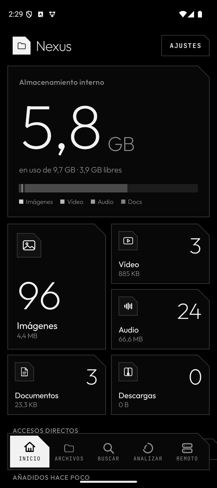
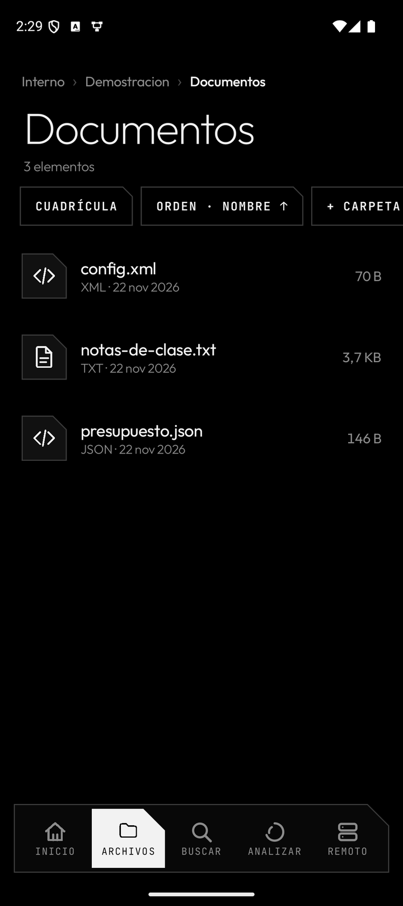
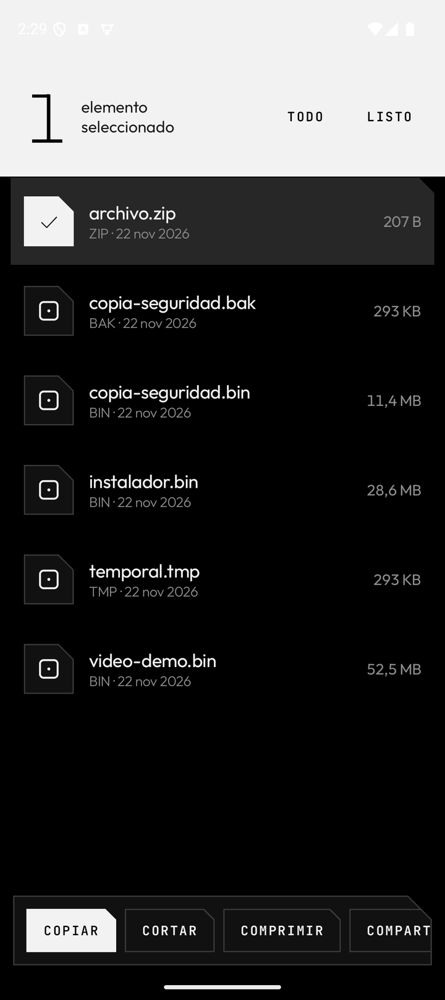
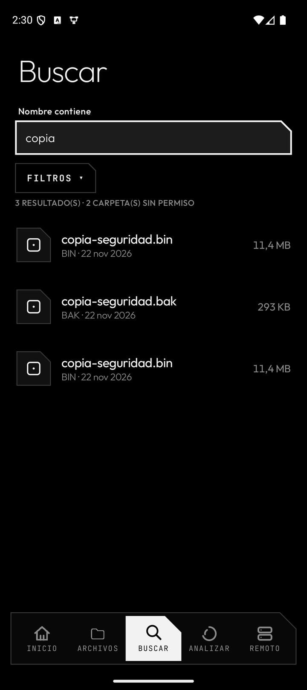
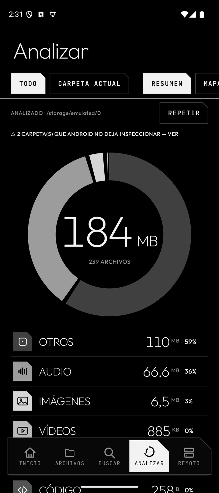
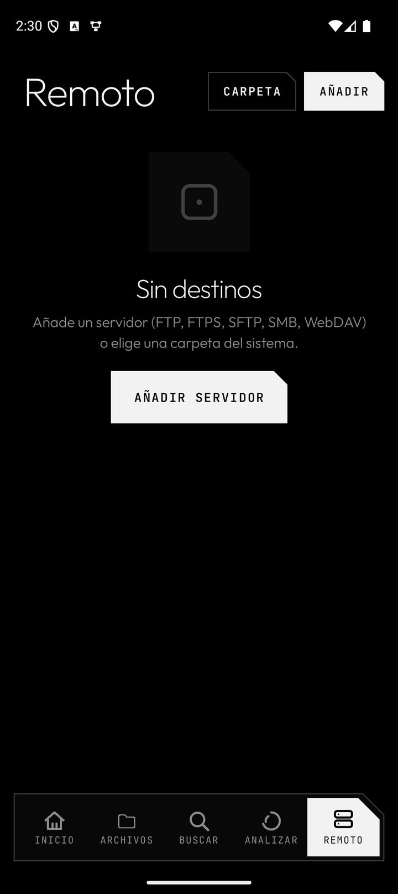
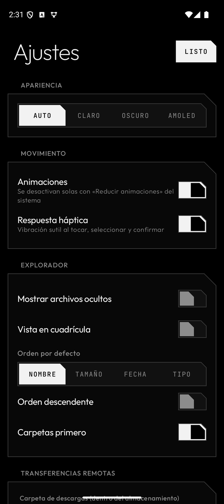

# NEXUS Files

Explorador de archivos avanzado para Android (Kotlin + Jetpack Compose): navegación local, búsqueda, analizador de espacio, ZIP, visores internos y destinos remotos (FTP, FTPS, SFTP, SMB, WebDAV y carpetas del sistema).

| Inicio | Archivos | Selección | Buscar |
|---|---|---|---|
|  |  |  |  |

| Analizador | Remoto | Ajustes |
|---|---|---|
|  |  |  |

Capturas reales (`adb screencap`) de la app release corriendo en un emulador Pixel_API36 (Android 16) con ficheros de demostración sintéticos creados para la ocasión; no contienen datos personales.

## Características

- **Explorador**: almacenamiento interno y SD, migas de pan, lista o cuadrícula, orden, ocultos, selección múltiple, copiar/cortar/pegar, mover, renombrar, borrar con confirmación, nueva carpeta, compartir y abrir con otra app. Copia atómica (`.nexus-part` + renombrado), sin sobrescribir salvo política explícita y sin seguir enlaces simbólicos.
- **Inicio y búsqueda**: almacenamiento con `StatFs`, categorías y recientes vía MediaStore, favoritos y etiquetas; búsqueda por nombre, extensión, tipo, tamaño, fecha y ubicación (avisa de las carpetas que Android no deja leer).
- **Analizador** (solo lectura): resumen por categorías, treemap navegable, listas de más grandes, carpetas pesadas, antiguos y temporales, y duplicados exactos (tamaño, hash parcial y SHA-256). Borrar siempre pide confirmación y es permanente (sin papelera).
- **ZIP**: listar, extraer (con protección contra zip-slip) y crear. **Visores internos**: JSON, XML, código, imagen, PDF, ZIP, audio y vídeo.
- **Remoto**: FTP y FTPS explícito, WebDAV, SFTP (contraseña o clave privada, con o sin frase de paso) y SMB2/3 con dominio opcional, más carpetas del sistema mediante SAF. Identidad del servidor fijada por huella (TOFU) antes de enviar credenciales, reanudación de descargas interrumpidas, reintentos con espera creciente y transferencias en un servicio en primer plano con notificación y botón de cancelar.
- Temas Sistema, Claro, Oscuro y AMOLED, y opción de reducir animaciones y respuesta háptica.

## Instalación

Descarga `nexus-files-0.1.0.apk` de la [última release](../../releases/latest) y comprueba el `sha256` publicado junto a él:

```
sha256sum -c nexus-files-0.1.0.apk.sha256
adb install -r nexus-files-0.1.0.apk
```

> **Aviso:** el APK está **firmado con la clave de depuración** de Android (el módulo `app` no define firma de release; el APK `release` compilado con R8 se firmó con `apksigner` y esa clave). Sirve para probar la app; no es una firma de producción, no pasa por Play Store ni Play Protect y Android puede avisar al instalarlo. Requiere Android 11 (API 30) o superior. Para distribuirla de verdad hace falta una clave propia.

## Permisos

| Permiso | Para qué |
|---|---|
| `MANAGE_EXTERNAL_STORAGE` | Acceso a todos los archivos, el flujo oficial de los gestores de archivos; se concede a mano en los ajustes del sistema. Sin él hay un modo limitado (solo Remoto y carpetas SAF) |
| `INTERNET` | Conectar con los servidores remotos que añadas |
| `FOREGROUND_SERVICE`, `FOREGROUND_SERVICE_DATA_SYNC` | Servicio en primer plano para copias, ZIP y transferencias largas |
| `POST_NOTIFICATIONS` | Mostrar el progreso con botón «Cancelar» (se pide una vez al arrancar) |

Las contraseñas y claves de los perfiles remotos se guardan cifradas (AES-256-GCM con Android Keystore).

## Compilar desde el código

Requisitos: JDK 17 o superior (el proyecto compila a Java 17; verificado con JDK 27), Android SDK con la plataforma 37 (`compileSdk 37`, `targetSdk 36`, `minSdk 30`) y el Gradle wrapper incluido. Módulos: `:core` (Kotlin puro, probado con JUnit) y `:app` (interfaz).

```
./gradlew :app:assembleDebug
./gradlew :app:assembleRelease     # R8 + recursos reducidos; sale sin firmar (app-release-unsigned.apk)
```

Para firmar el release con la clave de depuración, como hace la release publicada:

```
apksigner sign --ks ~/.android/debug.keystore --ks-pass pass:android \
  --ks-key-alias androiddebugkey --out nexus-files-0.1.0.apk \
  app/build/outputs/apk/release/app-release-unsigned.apk
```

Para probar en un emulador con ficheros reales: `adb shell appops set dev.nexus.files MANAGE_EXTERNAL_STORAGE allow`.

## Pruebas

```
./gradlew :core:test        # pruebas JVM del núcleo
./gradlew :app:testDebugUnitTest
```

Hay además pruebas opt-in contra servidores reales en el host (`NEXUS_IT=1`, `NEXUS_SMB=1`, etc.) descritas en [docs/NOTAS-TECNICAS.md](docs/NOTAS-TECNICAS.md), junto con el historial de fases, la verificación y las mediciones de rendimiento. Estas pruebas no se han vuelto a ejecutar al preparar esta publicación; sí se compiló el release y se comprobó que instala y arranca sin errores en el emulador.

## Identidad visual

Sigue la identidad visual de Takumi-Organization: negro y tinta clara, monocromo estricto (los tipos de archivo y los protocolos se distinguen por icono, texto y un gris propio, no por color), esquinas rectas con corte diagonal arriba a la derecha, selección por inversión y sin cristal. Tipografías **Outfit** y **JetBrains Mono**, bajo licencia SIL OFL 1.1: [Outfit](docs/OFL-Outfit.txt) y [JetBrains Mono](docs/OFL-JetBrainsMono.txt).

## Estado y límites conocidos

- Verificado en emulador contra servidores de prueba en local (wsgidav, pyftpdlib, asyncssh, impacket) y, el explorador y la fluidez del release con 3.000 archivos, en un móvil físico. No se ha probado con servidores o certificados reales de Internet.
- FTPS contra un servidor que exige reutilizar la sesión TLS **falla en Android** (Conscrypt); sin esa exigencia funciona.
- SFTP con claves ECDSA, ssh-agent o certificados de usuario, SMB con firmado/cifrado obligatorio o Kerberos, y proveedores SAF distintos del almacenamiento externo, sin verificar.
- Las categorías del analizador dependen del índice de MediaStore; los temporales se detectan por nombre o extensión.
- Al mover con cortar/pegar, los favoritos y etiquetas de esa ruta no se reasignan.
- Defecto visual observado al preparar las capturas (no corregido): el visor interno de JSON muestra los números de línea pero el texto no se ve.

## Licencia

[MIT](LICENSE), © 2026 Takumi-Organization. Las fuentes Outfit y JetBrains Mono se distribuyen bajo SIL OFL 1.1. Dependencias principales: JSch (fork mwiede, estilo BSD), smbj (Apache 2.0), BouncyCastle (MIT), AndroidX y Compose (Apache 2.0); todas compatibles con una licencia MIT.
